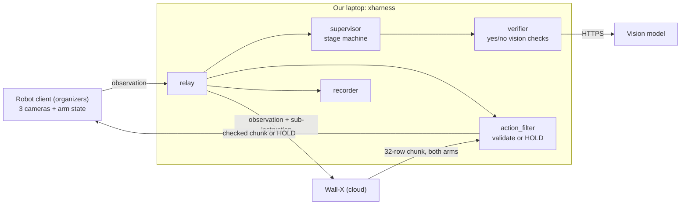

# xsquare-harness

The agent harness for our BRIGHT 2026 Embodied Agent Hackathon entry
(X Square desktop dual-arm robot, Wall-X VLA, Demo 2 "SnapFit Carrot").

It sits between the organizers' robot client and Wall-X, decides what the
robot should do next, checks every action chunk, knows when the task is
done, and keeps the arms still when it is. It includes a **fake robot**, a
**fake Wall-X** and a **fake vision model**, so the whole loop runs on a
laptop with no hardware.



## Quick start

```bash
python3 -m venv .venv && source .venv/bin/activate
pip install -r requirements.txt

python -m pytest -q                      # 28 tests, ~6 s, no network
python -m sim.run --case 3               # full Demo 2 case 3 on the fake robot
python -m sim.run --case 3 --faults standard --vlm-faults hostile --drop-connection 6
python -m xharness --check               # validate config + tasks, list warnings
```

Talk to the real Wall-X (organizers allow pre-event access):

```bash
export WALLX_API_KEY='sk-...'            # from the API Tutorial. Never commit it.
python tools/probe_wallx.py              # writes probe_out/report.md
export WALLX_HEADERS_FILE=probe_out/wallx-headers.json
python -m sim.run --case 3 --real-wallx  # real Wall-X, fake robot + fake vision
```

On site, see [docs/RUNBOOK.md](docs/RUNBOOK.md).

## Repository map

| Path | What it is |
|---|---|
| `xharness/protocol.py` | The public_v2 wire contract: encode, validate, build HOLD chunks |
| `xharness/relay.py` | WebSocket server the robot connects to; talks to Wall-X |
| `xharness/supervisor.py` | Stage machine: next instruction, retries, done detection, HOLD |
| `xharness/verifier.py` | Narrow yes/no questions to a vision model; never raises |
| `xharness/action_filter.py` | Last software gate before actions reach the robot |
| `xharness/recorder.py` | Every request, decision and camera frame to `runs/` |
| `xharness/tasks.py` | YAML task format (one file per A/B-board case) |
| `xharness/parts.py` | Demo 2 part dimensions and gripper feasibility check |
| `config/harness.example.yaml` | Annotated configuration |
| `config/tasks/*.yaml` | Demo 2 cases 1 to 3 as stage lists |
| `config/webui/local_d2_snapfit.json` | Matching task file for the WebUI (`/home/xr/diversity/`) |
| `sim/` | Fake world (real part sizes), camera renderer, fake robot, fake Wall-X, fake vision model |
| `tools/probe_wallx.py` | Probe the real Wall-X endpoint and write a report |
| `tools/workspace_from_runs.py` | Measure safe workspace boxes from recorded runs |
| `docs/DIFFICULTIES.md` | Every known hard problem and where the code handles it |
| `docs/ORGANIZER_QUESTIONS.md` | What we still need the organizers to answer |

## How a request is handled

1. The robot client sends an observation: three JPEGs, both arms' pose and
   gripper, and the case goal (the `instruction` from the WebUI task JSON).
2. The supervisor finds the task whose `goal` matches and looks at the
   current stage. Every `verify_every` requests it asks the vision model one
   question ("Is the teal button held by a gripper, off the table?").
3. Two consecutive "yes" (plus optional gripper and stillness checks) advance
   the stage. "unsure" never counts. Out of budget: retry with the next
   phrasing. Out of retries: the task fails and the arms hold still.
4. ACT: the relay swaps in the stage's instruction and forwards to Wall-X.
   The reply goes through the action filter, then to the robot.
5. HOLD: the relay answers itself with 32 rows of the current pose. Used
   when the task is done, failed, or Wall-X is unreachable.

## Design decisions (and why)

* **Fixed stages, not a free-form LLM planner.** Official runs are fully
  autonomous: nobody may touch a keyboard once a run starts (LAN traffic is
  monitored). A stage table is predictable, readable and testable offline.
* **Never close the robot connection on our own errors.** The example
  harness did; the client reconnects and the task restarts mid-motion.
* **Progress is keyed by goal and saved to disk**, so reconnects and harness
  restarts resume instead of repeating stages.
* **HOLD is our only "stop".** The model API cannot stop the robot. After the
  last stage we keep answering with HOLD until the run ends.
* **Unsafe chunks become HOLD (`filter.mode: enforce`)**: NaN, wrong shapes,
  big jumps, leaving the workspace. Confirm with organizers that replacing
  chunks is allowed; switch to `log` if not.

## What is still a placeholder (measure on site)

| Value | Where | How to get it |
|---|---|---|
| Gripper opening in mm vs command (0..1.526) | `xharness/parts.py` | Calipers at 4 command values |
| Gripper reading when closed on a part vs on nothing | `supervisor.grasp_band`, `open_above` | Close on a button, then on air; read `runs/*/events.jsonl` |
| Workspace boxes | `filter.workspace` | `tools/workspace_from_runs.py runs/` |
| HOLD chunk format accepted by the client | `protocol.build_response` | Compare with `probe_out/response_first.msgpack`; test HOLD once with the arm clear |
| Part colors | `config/tasks/*.yaml`, `xharness/parts.py` | Match what you actually printed |
| Case goals | `config/tasks/*.yaml` `goal` = WebUI JSON `instruction` | Keep both files in sync |

## Limits of the fake robot

`sim/` is kinematic, not physics: no forces, no tipping, no real optics.
It is for harness logic (stages, retries, faults, reconnects, done
detection). It says nothing about whether Wall-X can actually do the task.
Insertion tolerances (2 mm buttons, 4 mm slider, 5 mm shell) are guesses
that make precision failures show up.
