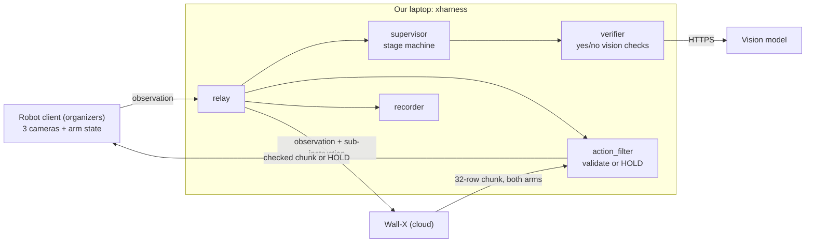

# xsquare-harness

The agent harness for our BRIGHT 2026 Embodied Agent Hackathon entry
(X Square desktop dual-arm robot, Wall-X VLA, Demo 2 "SnapFit Carrot").

## Team status (Nov 12): read this first

This is a **baseline so we're not starting from zero on Saturday, not the
plan.** Everything here is open for the team to change. Built by Galanafai
with Claude and Claude Code.

### What's done

- **Investigation:** organizer docs, the rules and X Square's repos. Key
  findings: Wall-X only moves the arms (no memory, no "done" signal), so the
  harness owns steps, checking and stopping. Score = (sum of 6 B-board
  cases) x K. Nobody may touch a keyboard once a run starts. X2Real is an
  Isaac Sim benchmark, not robot software.
- **Harness:** relay, step supervisor, yes/no vision verifier, safety
  filter with "hold still" replies, recorder, Wall-X pre-warm at startup.
- **Testing without hardware:** fake robot, fake Wall-X and fake vision
  model, using our real part sizes, with fault injection. 41 tests pass.
- **Real Wall-X measured** (`tools/probe_wallx.py`): auth is
  `Authorization: Bearer <key>`, about 0.6 s per call, 4 s first call after
  idle, exact reply format (our hold-still replies copy it).
- **Vision model wired in:** Qwen (`qwen/qwen3.8-27b`) on Groq answers
  correctly in about 1.2 s. Accuracy eval tooling exists (`tools/eval_verifier.py`).
- **Task files:** Demo 2 cases 1 to 3 and Demo 5 fallback drafts
  (`config/tasks/`), plus matching WebUI JSONs (`config/webui/`).
- **Docs:** [DIFFICULTIES](docs/DIFFICULTIES.md), [RUNBOOK](docs/RUNBOOK.md),
  [ORGANIZER_QUESTIONS](docs/ORGANIZER_QUESTIONS.md),
  [GRIPPER_FIRST_PROPOSAL](docs/GRIPPER_FIRST_PROPOSAL.md).

### Proven vs still a guess

| Proven (measured or tested) | Still a guess (needs the robot or organizers) |
|---|---|
| Wall-X auth, latency, reply format | Can Wall-X grasp a 10.7 mm button or seat the slider? |
| Instruction text steers Wall-X (up to 139 mm difference) | Does the robot client accept our hold-still replies? |
| Harness survives Wall-X crashes, timeouts, bad output, reconnects (sim) | Are we allowed to replace Wall-X's output at all? |
| No false "done" in 60 sim runs with a vision model lying 10% of the time | Real vision accuracy on real camera frames |
| Qwen on Groq answers correctly in about 1.2 s | Gripper mm opening; is the gripper reading measured or commanded? |
| 41 tests pass | Snap force of our prints; holder approval; venue latency |

### Architecture options (we can mix these)

| Option | Idea | Trade-off |
|---|---|---|
| A. Organizers' example | Vision LLM picks the next instruction every few Wall-X calls | Simplest, but drops the connection on errors and has no reliable "done" |
| **B. Fixed steps + yes/no checks (current baseline)** | We write the steps; the vision model only confirms each one | Predictable and testable, but rigid |
| C. B + gripper-first checks | Gripper reading decides grasp/release; vision only for "aligned" and "seated" | About a third to half fewer vision calls; needs the gripper reading to be measured |
| D. B's safety layer + free-form LLM planner | LLM chooses instructions from images; relay, filter, hold stay | More flexible for disturbance and look-alike cases; harder to test |
| E. Fine-tune Wall-OSS on our own demos | Collect teleop data on site, train, serve ourselves | Could fix precision insertion; too slow and risky for a 2-day event |

### Team decisions

1. **Demo 2 or Demo 5?** Demo 2 scores up to 4.5x, but the press steps are the
   riskiest for Wall-X. Demo 5 (K = 2.3) is mostly pick and place. What success
   rate on Saturday morning makes us switch?
2. **Planner style:** B, C, D, or a mix.
3. **Vision budget:** Groq free tier allows only about one 3-camera check per
   minute. Groq paid, self-hosted Qwen on RunPod, or fewer cameras per check?
4. **Physics sim (X2Real):** skip, or timebox (for example 3 hours, RTX GPU needed)?
5. **Who owns what:** prints and holder / vision model and real photos /
   organizer comms and runbook.
6. **Print colors:** task files assume white handle, orange slider, green shell,
   teal and purple buttons. Update `config/tasks/` and `xharness/parts.py` to match.

### Things to think about

- The biggest unknowns are physical. Saturday's first two hours of
  measurement (see RUNBOOK) will tell us more than more code tonight.
- The rules mention current/torque and depth data, but the Wall-X protocol
  doesn't carry them. The Demo 2 proposal leans on current feedback.
- The organizer email covers: replacing Wall-X output, who ends runs,
  current/torque access, holder approval, hold-still reply format.
- The X Square fireside chat is Friday 4 PM at the venue: a chance to ask
  in person.
- Keys (Wall-X, Groq) stay in environment variables, never in the repo.

---

## How it works
It sits between the organizers' robot client and Wall-X, decides what the
robot should do next, checks every action chunk, knows when the task is
done, and keeps the arms still when it is. It includes a **fake robot**, a
**fake Wall-X** and a **fake vision model**, so the whole loop runs on a
laptop with no hardware.



## Quick start

```bash
python3 -m venv .venv && source .venv/bin/activate
pip install -r requirements.txt

python -m pytest -q                      # 28 tests, ~6 s, no network
python -m sim.run --case 3               # full Demo 2 case 3 on the fake robot
python -m sim.run --case 3 --faults standard --vlm-faults hostile --drop-connection 6
python -m xharness --check               # validate config + tasks, list warnings
```

Talk to the real Wall-X (organizers allow pre-event access):

```bash
export WALLX_API_KEY='sk-...'            # from the API Tutorial. Never commit it.
python tools/probe_wallx.py              # writes probe_out/report.md
export WALLX_HEADERS_FILE=probe_out/wallx-headers.json
python -m sim.run --case 3 --real-wallx  # real Wall-X, fake robot + fake vision
```

On site, see [docs/RUNBOOK.md](docs/RUNBOOK.md).

## Repository map

| Path | What it is |
|---|---|
| `xharness/protocol.py` | The public_v2 wire contract: encode, validate, build HOLD chunks |
| `xharness/relay.py` | WebSocket server the robot connects to; talks to Wall-X |
| `xharness/supervisor.py` | Stage machine: next instruction, retries, done detection, HOLD |
| `xharness/verifier.py` | Narrow yes/no questions to a vision model; never raises |
| `xharness/action_filter.py` | Last software gate before actions reach the robot |
| `xharness/recorder.py` | Every request, decision and camera frame to `runs/` |
| `xharness/tasks.py` | YAML task format (one file per A/B-board case) |
| `xharness/parts.py` | Demo 2 part dimensions and gripper feasibility check |
| `config/harness.example.yaml` | Annotated configuration |
| `config/tasks/*.yaml` | Demo 2 cases 1 to 3 as stage lists |
| `config/webui/local_d2_snapfit.json` | Matching task file for the WebUI (`/home/xr/diversity/`) |
| `sim/` | Fake world (real part sizes), camera renderer, fake robot, fake Wall-X, fake vision model |
| `tools/probe_wallx.py` | Probe the real Wall-X endpoint and write a report |
| `tools/workspace_from_runs.py` | Measure safe workspace boxes from recorded runs |
| `docs/DIFFICULTIES.md` | Every known hard problem and where the code handles it |
| `docs/ORGANIZER_QUESTIONS.md` | What we still need the organizers to answer |

## How a request is handled

1. The robot client sends an observation: three JPEGs, both arms' pose and
   gripper, and the case goal (the `instruction` from the WebUI task JSON).
2. The supervisor finds the task whose `goal` matches and looks at the
   current stage. Every `verify_every` requests it asks the vision model one
   question ("Is the teal button held by a gripper, off the table?").
3. Two consecutive "yes" (plus optional gripper and stillness checks) advance
   the stage. "unsure" never counts. Out of budget: retry with the next
   phrasing. Out of retries: the task fails and the arms hold still.
4. ACT: the relay swaps in the stage's instruction and forwards to Wall-X.
   The reply goes through the action filter, then to the robot.
5. HOLD: the relay answers itself with 32 rows of the current pose. Used
   when the task is done, failed, or Wall-X is unreachable.

## Design decisions (and why)

* **Fixed stages, not a free-form LLM planner.** Official runs are fully
  autonomous: nobody may touch a keyboard once a run starts (LAN traffic is
  monitored). A stage table is predictable, readable and testable offline.
* **Never close the robot connection on our own errors.** The example
  harness did; the client reconnects and the task restarts mid-motion.
* **Progress is keyed by goal and saved to disk**, so reconnects and harness
  restarts resume instead of repeating stages.
* **HOLD is our only "stop".** The model API cannot stop the robot. After the
  last stage we keep answering with HOLD until the run ends.
* **Unsafe chunks become HOLD (`filter.mode: enforce`)**: NaN, wrong shapes,
  big jumps, leaving the workspace. Confirm with organizers that replacing
  chunks is allowed; switch to `log` if not.

## What is still a placeholder (measure on site)

| Value | Where | How to get it |
|---|---|---|
| Gripper opening in mm vs command (0..1.526) | `xharness/parts.py` | Calipers at 4 command values |
| Gripper reading when closed on a part vs on nothing | `supervisor.grasp_band`, `open_above` | Close on a button, then on air; read `runs/*/events.jsonl` |
| Workspace boxes | `filter.workspace` | `tools/workspace_from_runs.py runs/` |
| HOLD chunk format accepted by the client | `protocol.build_response` | Compare with `probe_out/response_first.msgpack`; test HOLD once with the arm clear |
| Part colors | `config/tasks/*.yaml`, `xharness/parts.py` | Match what you actually printed |
| Case goals | `config/tasks/*.yaml` `goal` = WebUI JSON `instruction` | Keep both files in sync |

## Limits of the fake robot

`sim/` is kinematic, not physics: no forces, no tipping, no real optics.
It is for harness logic (stages, retries, faults, reconnects, done
detection). It says nothing about whether Wall-X can actually do the task.
Insertion tolerances (2 mm buttons, 4 mm slider, 5 mm shell) are guesses
that make precision failures show up.
